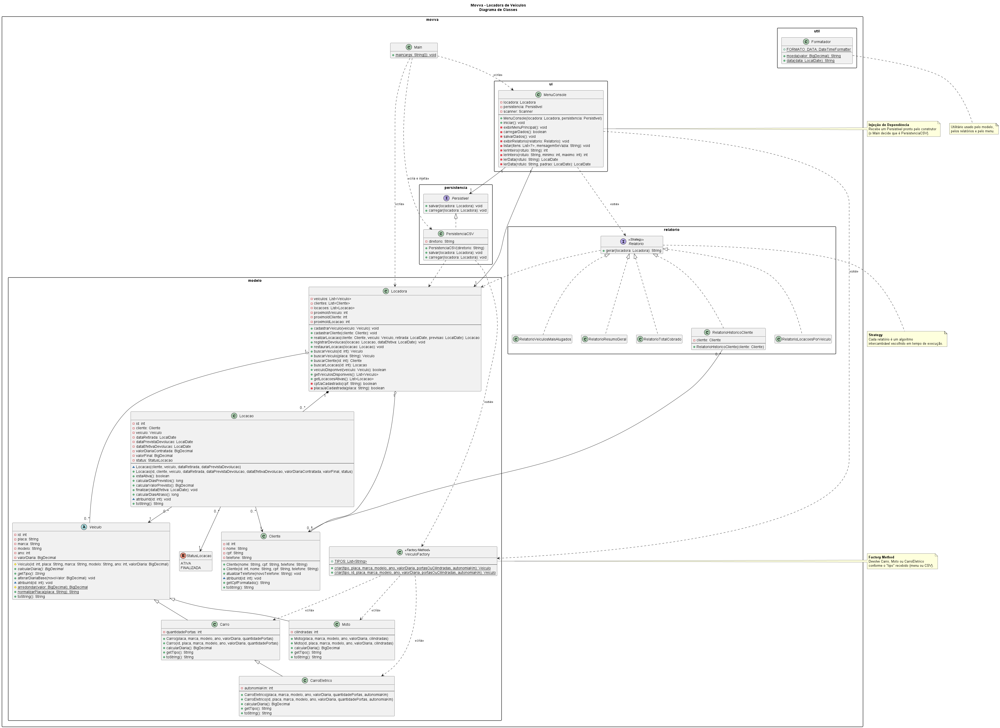

# Movva — Locadora de Veículos

Aplicação de console em **Java puro** para a locadora fictícia **Movva**. Desenvolvida como Trabalho do Grau B da disciplina de Programação Orientada a Objetos (Unisinos).

O sistema cadastra veículos (carros, motos e carros elétricos) e clientes, registra locações e devoluções (com cálculo de multa por atraso), emite relatórios e salva tudo em arquivos CSV.



> Fonte do diagrama: [docs/movva.puml](docs/movva.puml) (PlantUML).

---

## Como executar

**Requisito:** JDK 17 ou superior (desenvolvido com o JDK 21).

### Terminal (VS Code / PowerShell), na raiz do projeto

```powershell
chcp 65001
javac -encoding UTF-8 -d bin (Get-ChildItem -Recurse src -Filter *.java).FullName
java "-Dstdout.encoding=UTF-8" -cp bin movva.Main
```

`chcp 65001` e `-Dstdout.encoding=UTF-8` fazem os acentos aparecerem corretamente no console do Windows.

### Eclipse

1. *File → Import → Existing Projects into Workspace* e selecione a pasta do projeto.
2. Confira se *Project → Properties → Resource → Text file encoding* está em **UTF-8**. O arquivo `.settings/` do projeto já define isso.
3. Clique com o botão direito em `src/movva/Main.java` e escolha *Run As → Java Application*. Digite as opções no painel *Console*.

Os dados ficam na pasta `dados/`, relativa à raiz do projeto. Para voltar aos dados de exemplo originais, use `git restore dados/`.

---

## Funcionalidades

| Menu | Opções |
|---|---|
| **1 - Veículos** | cadastrar (carro, moto ou elétrico), listar todos, listar disponíveis, buscar por id, buscar por placa, alterar diária base |
| **2 - Clientes** | cadastrar, listar, atualizar telefone |
| **3 - Locações** | nova locação, registrar devolução, listar ativas, listar todas |
| **4 - Relatórios** | resumo geral, total cobrado, histórico de um cliente, locações por veículo, veículos mais alugados |
| **5 - Salvar dados** | grava os CSV (o sistema também salva automaticamente ao sair) |

### Regras de negócio

- **Diária por tipo de veículo (polimorfismo):**
  - **Carro:** diária base, com +10% se tiver 4 portas ou mais.
  - **Moto:** diária base, com −15% se tiver até 300 cc.
  - **Carro elétrico:** a regra do carro mais R$ 25,00 de taxa de recarga.
- **Diária congelada:** a locação guarda a diária vigente no momento da locação. Mudanças posteriores no preço não afetam contratos já feitos.
- **Valor final da devolução:** dias usados × diária (mínimo de 1 dia), mais multa de **20% da diária por dia de atraso**.
- **Validações:**
  - Placa e CPF não podem se repetir.
  - Um veículo não pode ter duas locações ativas ao mesmo tempo.
  - Uma locação não pode ser devolvida duas vezes.
  - Datas e números digitados errado são pedidos novamente, sem derrubar o programa.

---

## Requisitos do trabalho × implementação

| # | Requisito | Onde está |
|---|---|---|
| 1 | Diagrama de classes UML | [docs/movva.puml](docs/movva.puml) e [docs/movva-diagrama-uml.png](docs/movva-diagrama-uml.png) |
| 2 | Herança simples | `Veiculo → Moto` ([Moto.java](src/movva/modelo/Moto.java)) |
| 3 | Herança multinível (3 níveis) | `Veiculo → Carro → CarroEletrico` ([CarroEletrico.java](src/movva/modelo/CarroEletrico.java)) |
| 4 | Classe abstrata / interface | `Veiculo` é abstrata ([Veiculo.java](src/movva/modelo/Veiculo.java)); interfaces `Relatorio` e `Persistivel` |
| 5 | Polimorfismo (sobrescrita) | `calcularDiaria()`, `getTipo()` e `toString()` nas três subclasses de `Veiculo`; `gerar()` nos 5 relatórios |
| 6 | Persistência em arquivo-texto | [PersistenciaCSV.java](src/movva/persistencia/PersistenciaCSV.java), com os arquivos `dados/veiculos.csv`, `clientes.csv` e `locacoes.csv` |
| 7 | Sobrecarga | `Locadora.buscarVeiculo(int)` / `buscarVeiculo(String)`; construtores com e sem id em `Cliente`, veículos e `Locacao`; `VeiculoFactory.criar(...)`; `lerInteiro` e `lerData` no menu |

### Relacionamentos UML presentes

- **Generalização:** a hierarquia de `Veiculo`.
- **Realização:** as implementações de `Relatorio` e `Persistivel`.
- **Associação:** `Locacao → Cliente / Veiculo / StatusLocacao`, `RelatorioHistoricoCliente → Cliente`, `MenuConsole → Locadora / Persistivel`.
- **Agregação:** `Locadora ◇ Veiculo` e `Locadora ◇ Cliente`.
- **Composição:** `Locadora ◆ Locacao`. Só a `Locadora` cria locações.
- **Dependência:** relatórios e persistência usam a `Locadora`; a fábrica cria os veículos; o `Main` monta os objetos.

### Padrões de projeto (extra — Aula 15)

| Padrão | Onde | Para quê |
|---|---|---|
| **Factory Method** (criacional) | [VeiculoFactory.java](src/movva/modelo/VeiculoFactory.java) | Cria `Carro`, `Moto` ou `CarroEletrico` a partir do "tipo" recebido. Menu e leitura do CSV não conhecem as classes concretas. |
| **Strategy** (comportamental) | [Relatorio.java](src/movva/relatorio/Relatorio.java) e as 5 implementações | Cada relatório é um algoritmo intercambiável, escolhido em tempo de execução pelo menu. |
| **Injeção de Dependência** | [Main.java](src/movva/Main.java) → [MenuConsole.java](src/movva/ui/MenuConsole.java) | O menu recebe um `Persistivel` pelo construtor. Trocar CSV por outro formato não altera o menu. |

---

## Estrutura

```
src/movva/
├── Main.java                 ponto de entrada: monta e injeta as dependências
├── modelo/                   domínio e regras de negócio
│   ├── Veiculo.java (abstrata), Carro.java, Moto.java, CarroEletrico.java
│   ├── VeiculoFactory.java   Factory Method
│   ├── Cliente.java, Locacao.java, StatusLocacao.java (enum)
│   └── Locadora.java         cadastros, locações, validações
├── relatorio/                Relatorio (Strategy) + 5 relatórios
├── persistencia/             Persistivel + PersistenciaCSV
├── ui/                       MenuConsole (menus e leitura segura do teclado)
└── util/                     Formatador (moeda e datas)
dados/                        CSV com os dados de exemplo
docs/                         diagrama UML e roteiro de apresentação
```
